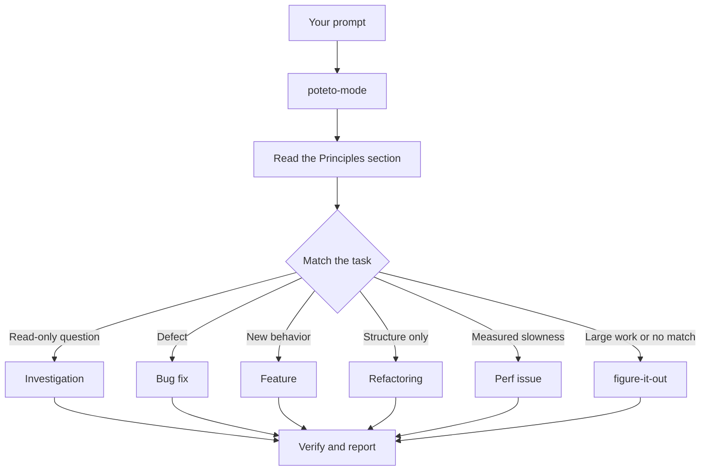

# 用 `/poteto-mode` 分派工作

`/poteto-mode` 是前门。你给它一个目标，它从二十二本手册（playbook）里匹配一本，把那本手册的步骤抄进待办清单，按步骤需要叫来其他技能（skill）。这一页教你好提示词（prompt）长什么样，以及你实际需要的提示词有多短。


## 你的提示词经历了什么



图里画的是常见路线。手册还有这些：把某个指标持续爬坡改进、诊断运行时症状和捕获的追踪、做原型、像素级一致、编写与评估技能、自主运行、开 PR、把 PR 或一摞 PR 看护到可合并、交付已验证的一摞、用自动驾驶跑一个 PR 队列或一摞、会话接续、安全暂停、多阶段计划，以及工作树（worktree）清理。[手册目录](../../skills/poteto-mode/playbooks/) 里有全套。

## 说目标，别搞仪式

你不用写规格说明。你说哪里不对，或你想要什么，再加上任何已知的、能给代理（agent）省时间的信息：

```text
/poteto-mode users get two notifications after a retry. repro first, then fix and verify.
```

这就是一条 Bug fix 提示词。"先复现"是真约束，不是客气，手册会照办。看着待办清单被 Bug fix 的步骤填满。

<a id="what-goes-in-a-prompt"></a>
## 提示词里该写什么

一条有用的提示词最多带五样东西，每样一句话就装得下：

- **目标。**说哪里不对，或你想要什么。
- **完成检查。**它必须能过或能挂。"弄好点"和"干一小时"都不算检查。
- **你想看到的证据。**要真实的命令输出、流程的录屏、存下来的值，或一组前后数字。
- **你已经知道的。**一个症状、一个复现步骤、一行日志或一个链接，都能给代理省一次搜索。
- **真约束。**"先复现"、"先别改任何代码"、"行为零变化"、"动手前先让我过目"，每一条都会改变代理的做法。

下面这条五样俱全：

```text
/poteto-mode the csv export drops its last row since yesterday's deploy. failing job id is 4812. repro first, then fix. done means the 60k-row fixture exports every row. show me the row counts before and after.
```

有两样东西值得留白：

- **怎么做。**说清要达到什么，给代理留出空间，让它找到比你选的更好的路。技能清单同理，见下面的坑。
- **你对原因的猜想，先别说。**说出口的猜测会把搜索钉死在你指的方向。先让代理复述问题，再分享你的直觉。

报告很吵的时候，比如一长串讨论或一个含糊的 bug，把复述定为第一步：

```text
/poteto-mode read this thread. restate the underlying issue in your own words, in plain english. don't change any code yet.
```

读错的地方会先冒在复述里，那时还没有任何代码。在那里纠正，花你一条消息，而不是一个错误的修复。只想看复述、不走手册的话，跑 [`/in-your-own-words`](../../skills/in-your-own-words/SKILL.md)。它会复述代理理解的你的目标，以及你想解决的问题。

拿不准提示词瞄得对不对时，发出去之前先对它跑 [`/sharpen`](../../skills/sharpen/SKILL.md)：

```text
/sharpen write a migration guide for the v2 config format.
```

代理会说出顶尖高手会做而你没要求的事、他们起步用的最原始材料、他们会用的方法和工具，以及除了你和代理之外，还有什么能证明结果是对的。然后它重写你的提示词，要的正是这些，更深但不更大。重写后的提示词要求代理把实验能定夺的选择都做原型，基于观察推荐一个选项，把产品和偏好类选择留给你。它不做任务本身。读一遍重写，再发出去，比如用 `/poteto-mode` 发。

## 追问要短

对话已经带着上下文时，提示词可以缩到几乎为零。下面这些都够用：

```text
/poteto-mode do it
```

```text
continue
```

```text
keep going until done
```

短之所以够用，是因为结构由手册托着，Custom Mode（自定义模式）让 `/poteto-mode` 每一轮都留在上下文里。[配置 pstack](./01-setup.md#run-your-first-task) 讲了怎么开一个。你的话带着意图，技能带着严谨。

## 用 "new task" 切换任务

长对话会积着上个任务的上下文。换话题时说一声：

```text
/poteto-mode new task. figure out why the cache entry survives logout. don't change any code yet.
```

"new task" 让 `/poteto-mode` 重新匹配，而不是继续上一本手册。"先别改任何代码"把这一发钉在 Investigation 上。缺了这两句，正跑到 Feature 中途的模式会把你的问题当成下一个功能步骤。

## 给并行工作各自一台机器

如果你在同一台电脑上让几个代理跑同一个仓库，它们会为工作区、端口和构建产物打架。最干净的隔离是[云端子代理](https://cursor.com/docs/subagents#cloud-subagents)。每个子代理（subagent）有自己的 VM 和分支，可以装依赖、跑你的应用、给结果录视频，全程不碰你的机器。在任务前输入 `/in-cloud`，或让父对话把工作交给云端子代理。

工作必须留在本地时，一开始就点名要工作树：

```text
/poteto-mode new task. branch off <base> in a fresh worktree, then port the parser change there.
```

每个任务各有自己的分支和工作树，就没有代理会踩别人的文件。工作树吃磁盘和机器资源，笔记本一次只跑得动几个。[Opening a PR 手册](../../skills/poteto-mode/playbooks/opening-a-pr.md) 处理代码改动时本来就在工作树里干活，所以多数时候只有特定基底或位置要紧时你才需要说这句。

工作树会越积越多。磁盘吃紧时问一句：

```text
/poteto-mode what's eating my disk? prune the worktrees that are safe to prune.
```

[Worktree cleanup 手册](../../skills/poteto-mode/playbooks/worktree-cleanup.md) 按合并状态、未提交的工作和还有哪些对话在碰它，给每个工作树分类。它只删证据确凿的，凡是有未提交工作的都停下来等你定夺。

## 留它自己跑下去

你要走开时，说清什么算做完，然后走人：

```text
/poteto-mode im stepping away. keep going until the migration check reports zero old callers. log your decisions.
```

要回头再看的工作会走 [`/figure-it-out`](../../skills/figure-it-out/SKILL.md)，它设计这一轮的阶段，并用 [`/show-me-your-work`](../../skills/show-me-your-work/SKILL.md) 记决策日志。[睡觉时让工作继续跑](./07-overnight.md) 讲全了通宵契约。

**坑：**别在提示词里点名技能（"用 /architect，然后 /arena，然后 /interrogate……"）。手册本来就排好了顺序，手写的顺序通常会把手册本来要保的步骤重排或丢掉。只有想覆盖某个具体选择时才点名技能。

完整的路由规则请读 [`poteto-mode`](../../skills/poteto-mode/SKILL.md) 本身。

下一章：[理解代码](./03-understand.md)。
