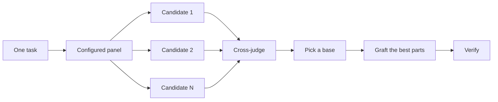

# 写代码之前先做设计

难题的设计只试一次，就会把模型想到的第一个形状锁死。`/architect` 在实现之前定下类型与边界。`/arena` 对同一份简报跑多路尝试，再合并最好的部分。`/interrogate` 让其他模型来攻破结果。任务要的是覆盖面而不是设计合成时，`/swarm` 沿切片或竞速铺开，汇总各自的结果。

最常见的两个设计错误：拿了代理（agent）的第一个设计，以及打磨一份没有任何代码检验过的计划。这一页两个都治。你用代码做规划。原型回答悬而未决的问题，README 或教程立起目标，书面计划最后才写。


## 用 `/architect` 定下形状

```text
/architect design the import pipeline before writing any code. i care most about how callers use it.
```

[`/architect`](../../skills/architect/SKILL.md) 先追踪这次改动碰到的每个系统。然后勾两个不同的形状，各带类型、签名和模块边界，挑出这样一份：每份状态只有一个归属，每件事只有一种做法，调用方需要知道的最少。设计大或有争议时，它改跑 `/arena` 而不是独自勾画。想在任何代码之前先看到设计，就在提示词（prompt）里说清。

代码开写之后设计就不是圣旨。同一个变通方案反复出现时，`/architect` 会重新设计，而不是在它周围打补丁。

## 用 `/arena` 铺开多路尝试

```text
/arena take my prompt to the arena verbatim. i want to compare their proposals with yours.
```

[`/arena`](../../skills/arena/SKILL.md) 是底下的通用工具。N 个子代理（subagent）并行尝试同一份设计或代码简报，各自写进自己的工作树（worktree）或目录。来自另一家模型厂商的只读评审按评分表给每个候选打分。没有别家的模型可跑时，协调者跳过评审，自己选基底。协调者把每个候选从头读到尾，选一个基底，把落选者里最好的想法嫁接进来，再验证结果。



面板来自你的 [`/setup-pstack`](../../skills/setup-pstack/SKILL.md) 配置，你可以按任务调整。决定要紧时多要几个候选，不要紧时少要：

```text
/arena this, 5 candidates. the cache key format is expensive to change later.
```

## 用 `/swarm` 覆盖切片与竞速

```text
/swarm check every package under packages/ against its check.sh. one worker per package. one report.
```

[`/swarm`](../../skills/swarm/SKILL.md) 把 N 个工作单元铺到独立切片、覆盖矩阵、试炼通道、探索分区或已声明的竞速分支上。每个工作单元有自己的范围和检查，然后汇报 `PASS`、`ISSUES` 或 `BLOCKED`。父级等工作单元齐了，回报一份紧凑的报告，列出缺口和掉队项。

并行能换来覆盖面，或能让独立检查互相竞速时，用它。`/arena` 给每个工作单元同一份设计或代码简报，然后选基底、嫁接最好的部分。`/swarm` 覆盖切片，或按事先声明的选择规则跑一场竞速。它不用选基底加嫁接那套仪式。

## 用 `/interrogate` 攻破它

```text
/interrogate the whole branch, but skeptically. no nitpicks unless it's an actual bug or regression.
```

[`/interrogate`](../../skills/interrogate/SKILL.md) 把这次改动和它的意图交给配置在各模型上的对手，每个对手都用真实代码跑一跑，试着攻破它。不同的对手找到不同的破绽。一条发现只有在重跑它的命令、确实出现违背意图的失败时才留存。报告列出每条验证过的发现和找到它的对手，再列每个对手丢弃了什么、为什么丢，报告不应用任何修改。

Dropped 清单也要读。裁定可以被你推翻。

## 用原型代替争论

永远别拿第一个设计。多要几个，从看得见的证据里挑：

```text
/poteto-mode prototype a few options for the new dropdown menu. take screenshots or videos for me to compare.
```

[Prototype 手册](../../skills/poteto-mode/playbooks/prototype.md) 在草稿目录里搭用完即弃的草样，把各变体接到一个切换器后面，逐个驱动，截屏或计时。它对行为和算法也好使，不止 UI。原型就是用代码做规划。代理靠跑点什么来回答自己的悬置问题，而不是来问你，还给一个你想不到的选项留了位置。

同一个思路可以放大到真实设计。把 `/architect` 和原型配对，留一道检查关卡（gate）：

```text
/poteto-mode we need rate limiting for external webhooks. /architect it first, and answer open questions with prototypes. let me review before proceeding.
```

别把对手浪费在抽象计划上。`/interrogate` 会丢弃一切没被运行证实的发现，背后没有代码的计划没多少东西可攻。让原型去定问题，然后审查看建出来的东西。

## 共享代码先写 README

给其他代码用的包或 API，从用户会读的那份文档写起：

```text
/poteto-mode write a tutorial for how i would use the new config package first. then /teach me why it beats the current one.
```

先写教程，逼你站在调用方的视角。你向一个假想用户描述 API，再倒推回实现。文档也成了具体靶子，代理对着它自查工作。文档本身要紧时，点名 [`/technical-writing`](../../skills/technical-writing/SKILL.md)，好让教程还是教程，不会漂成参考手册和讲解的大杂烩。

## 设计定下来之后再做计划

pstack 没有规划技能（skill），这是有意的。你真要一份书面计划时，等设计定下来再要：

```text
/poteto-mode turn this design into a plan. small verifiable PRs, each with its own verification steps.
```

[Multi-phase plan 手册（playbook）](../../skills/poteto-mode/playbooks/multi-phase-plan.md) 用原型定掉剩下的悬置问题，然后每个 PR 写一节，每节收在改动确实管用的证据上。光是测试套件全绿不算这个证据。计划就是交付物。手册不负责实现，只有你说开工才动手。

迁移的话，在提示词里把标准说死：

```text
/poteto-mode plan the migration of our ui library to the new styling system. small verifiable PRs, each with visual regression checks. the result must match the original exactly, bugs included.
```

"连 bug 一起"防的是迁移途中顺手修东西，那样新旧输出就没法比了。跨很多天的项目，你可以先把计划提交进仓库放一阵，让别的代理看到在建的活。工作落地后删掉。

## 一个任务配多少设计工作？

你可能想问是不是每次改动都要这一套。不。大多数改动一样都不需要。粗略的梯度：

- 小而做完、你又拿不准的改动，只用 `/interrogate`。
- 跨函数边界或转移归属的改动，值得上 `/architect`，设计大或有争议时它还会带上 `/arena`。
- 独立的决定，多路尝试能帮上忙的，比如命名、格式或某个算法，直接上 `/arena`。
- 覆盖矩阵、一组并行检查，或有声明分支的竞速，上 `/swarm`。
- 跑点什么就能回答的悬置问题，比如布局、时序或某种做法，给原型，不给争论。
- 有争议且难以回退的设计，上 `/architect`，上线前再过 `/interrogate`。
- 跨多个 PR 的工作给一份计划，等设计定下来再写。

`/poteto-mode` 已经在套用这个梯度。跨边界的工作会自动触发 `/architect`，所以你直接点名这些，多半是想要比默认更多或更少的审视。

下一章：[构建并清理改动](./05-build-and-clean.md)。
