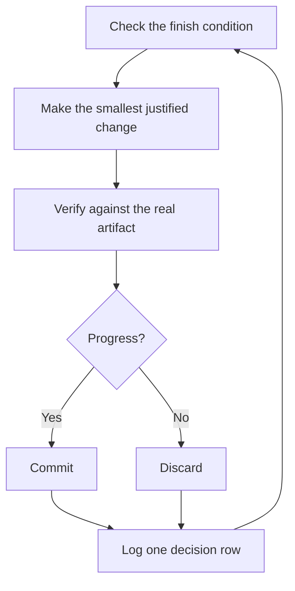

# 睡觉时让工作继续跑

这是前面所有功夫的回报。一个你信得过、会自己验证自身工作的代理（agent），才是能被独自留在硬任务上的代理。让这件事安全的不是希望。是可检查的完成条件、一棵隔离的工作树（worktree）或一个云端代理，还有一份你早上来审查的决策日志。


## 先赢得信任，再开循环

一个你不信任的循环只是更快地产出没人检查的工作，而且每轮迭代都让烂摊子复利。在把它留下跑之前，先检查它挣得这份信任没有：

- 你亲手做过一次这个任务，或者看代理做过一次，所以你知道什么叫做得好。
- 代理手里的工具和信号跟你自己会用的一样：验证技能（skill）、剖析器、日志。
- 每个阶段都自证其工作，并且在工作不达标时能叫停整条线。
- 你读过几份转录（transcript），并把反复出现的失败变成了工具、技能或检查。

四条全部成立之后，才让循环自主跑。在那之前，跑在你眼皮底下。

## 通宵契约

一份好的交接要有目标、完成条件、权限，还有一个逃生舱口。它不必很长：

```text
/poteto-mode im going to bed. migrate every caller to the new parser in a fresh worktree off <base>.
done means zero old callers, all parser fixtures pass, old api deleted.
keep a decision log. don't ask me before committing.
/loop until done. if you're truly stuck after a few hours, stop and write up why.
```

逐行看看每行给你换来什么：

- "im going to bed" 是一次会话级覆盖。代理不再问，继续干。
- "done means..." 把目标变成每轮迭代都能跑的检查。
- "fresh worktree off `<base>`" 让这次运行不会跟你手头其他开着的东西撞上。
- "don't ask me before committing" 提前回答了代理本来会卡住的那个权限问题。
- `/loop` 是 Cursor 内置的唤醒机制，不是 pstack 的技能。[Autonomous run 手册（playbook）](../../skills/poteto-mode/playbooks/autonomous-run.md) 用它在事件发生或心跳时重新检查完成条件。
- 逃生舱口让它在真走进死胡同时停下来写清缘由，这胜过八个小时对目标的创造性再解读。

因为这摊活你要离开之后才回来审，`/poteto-mode` 会把它路由给 [`/figure-it-out`](../../skills/figure-it-out/SKILL.md)，后者在写任何代码之前先设计这次运行的各个阶段，并把决策日志接进来。

想主动叫停一次运行，就告诉代理暂停，或者告诉它你快要下线或重启 Cursor 了。[Pause safely 手册](../../skills/poteto-mode/playbooks/pause-safely.md) 会完成或退出当前步骤，提交一个进行中检查点，再写一份续跑说明。一个新会话通过 Session pickup 手册照着这份说明把活接走。说"keep going"永远不会触发暂停。

## 循环整夜都在干什么



每轮迭代一次改动、一次检查、一行日志。没帮上忙的改动直接丢弃，不留着搭车。平台期意味着转向，不是停手，完成条件也从不悄悄放宽来宣告胜利。

## 早上的审查

[`/show-me-your-work`](../../skills/show-me-your-work/SKILL.md) 是让这次运行变得可审的东西。每行记录时间、阶段、决策、理由、一个证据指针和结果，存成 `decisions.tsv` 里的 TSV（多个运行共用一个目录时则是 `.audit/<task-slug>.tsv`）。它默认留在本地。工作规模大到审查者需要凭轨迹才敢信结果时，就把它提交进仓库。

回来以后，用审查形态要这份运行记录：

```text
/show-me-your-work catch me up on what you did last night
```

在技能交回总结之前，它会派生一个不同模型家族的评审来读轨迹和转录，回复以一个 Attention 小节收尾，列出值得你细看的东西。先读那一节，再读它指向的日志行。你审的是决策，不是把整晚重读一遍。

想要快速状态而非一次审查，在跑活的那个会话里跑 [`/ketchup`](../../skills/ketchup/SKILL.md)。它只读不写，用大白话告诉你自你上条消息以来变了什么，附上工作产出的截图和小图。然后它列出每一个等你拍板的决策，比如一次合并、一次批准或一次方案取舍，附上它的推荐、证据和风险，让你只凭回复就能拍板。

## 当一晚装的是队列，不是单个任务

上面那份契约把一个任务驱动到一个完成条件。有些晚上装的不止这些，一队独立改动，或者一整个工程。两本手册和一份技能把同样的信任放大。

[Autopilot-full](../../skills/poteto-mode/playbooks/autopilot-full.md) 把一队独立 PR 跑到合并为止。每个 PR 配一个负责代理，从构建一路带到合并，但没有哪个负责人凭自己的裁定就合并。负责者交出代码就绪的分支头时，一群全新的验证代理来检查它。后续的变基或小修只配一个全新的验证者，只有新行为或一大块新 diff 才把整群再叫回来。只有对最终合并的那个补丁给出干净裁定，才放行合并：

```text
/poteto-mode full autopilot on this queue. each item is independent. i want them merged by morning.
```

[Autopilot-stack](../../skills/poteto-mode/playbooks/autopilot-stack.md) 是去掉合并的 Autopilot-full。你一觉醒来，是一摞各自带着裁定的已验证 PR，由你亲自审查、亲自落地。一个 PR 只叠在它确实基于的 PR 上。想在任何东西合并前亲眼过一遍工作时，就选它而不是 Autopilot-full：

```text
/poteto-mode autopilot these five changes, but don't merge. i'll land them in the morning.
```

一整个工程，比如横跨许多包的迁移，没有自己的专属手册。`/poteto-mode` 把大型或横切多处的工作路由给 [`/figure-it-out`](../../skills/figure-it-out/SKILL.md)，由它为此设计一次严谨的运行：

```text
/poteto-mode migrate every package to the new store. own it until each one is converted and merged. i'll check in twice a day.
```

<a id="run-many-projects-in-parallel"></a>
## 并行跑多个 Project

一个 [Cursor Project](https://cursor.com/blog/projects) 给协调代理一条持久线程。协调者不写代码。它指挥子代理（subagent），子代理默认跑在云端，所以笔记本合上盖子后工作照样继续。给协调者的提示词（prompt）以 `/poteto-mode` 开头，它派生的子代理就会照手册走。它启动的每个代理都先读 [`worker.md`](../../skills/poteto-mode/worker.md)，这样工作单元（worker）就守住开工时定下的标准，可逆的决策自己拍板而不是来问你，开出的 PR 随时可审。

几个习惯帮得上忙：

- 每摊工作配自己的 Project，比如一个功能、一次迁移、一轮性能冲刺、一次技术债清理。几个可以并排跑。
- 把相关会话拖进这个 Project，已结束的也算。它们会成为其中每个代理的上下文。
- 每个 PR 合并前都过一群验证代理，队列交给 Autopilot-stack 或 Autopilot-full 带着走。
- 向协调者要一份有数据支撑的计划，并让它用原型回答悬而未决的问题，而不是来问你。

一条提示词就能承载一整个 Project，从调研一路到执行：

```text
/poteto-mode refactor this repo so its architecture is more agent friendly. use /correct and /architect on past commits and review comments to find the mistakes agents make most here. use /recall for context from past chats. answer open questions with prototypes instead of asking me. come back with a plan backed by real data. once i approve it, run it with autopilot-stack or autopilot-full, and ask me which.
```

## 让循环自己启动

上面每个循环仍然等你来启动。定时或事件驱动的自动化把这一步去掉。软件维护正好能拆成适配这种做法的几个阶段：给报告分诊、复现、修复、验证修复。两条规则让这样一条流水线值得信任：

- 每个阶段都能叫停整条线。分诊可以判定报告描述的是预期行为，复现可以复现不出来，修复者可以判定改动风险太大。这几种结果都有用，因为它们拦住坏工作进入下一阶段，而越往后撤销的代价越大。
- 每个阶段都交出证据。复现附上坏状态的截图和视频，修复附上前后对比的证明。这样人类不读一行代码，就能先检查代理修的是不是正确的东西。

pstack 把这套东西做成一个休眠的 [自动化包](../../automations/benny/README.md)，用于 Slack 的问题报告。一份自动化给每份报告分诊。另一份复现已确认的 bug，还可能准备一个小的草稿修复。让一个代理读它的 [`FOR_AGENTS.md`](../../automations/benny/FOR_AGENTS.md) 并点名目标仓库，即可完成设置。

**坑：**时长不是完成条件。"work on this for 4 hours" 没给代理任何可检查的东西，你醒来面对的是四个小时的动作，不是一个结果。给 `/loop` 一个能通过或失败的谓词。

下一章：[用原则（principle）名字掌舵](./08-principles.md)。
